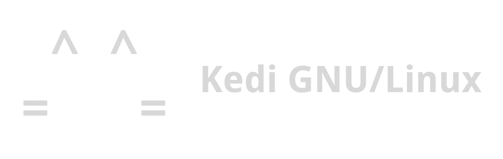

**English** · [Türkçe](#türkçe)

## About

Kedi GNU/Linux is an OpenRC-based fork of Pisi GNU/Linux, with a simple PID 1. It uses Pisi's packages and the PISI (Packages Installed Successfully as Intended) package manager, and its LXQt desktop is aimed at older and low-end computers. Installation instructions are on the [wiki](https://kedilinux.org/wiki), along with notes on using OpenRC and PISI.

This repository holds the recipes (`pspec.xml`, `actions.py`) for the packages Kedi adds or changes. Everything else comes from Pisi; its recipes are in [pisilinux/core](https://github.com/pisilinux/core) and [pisilinux/main](https://github.com/pisilinux/main). The binary repository at repo.kedilinux.org combines Kedi's packages with a mirror of stable2.pisilinux.org.

## Status

Kedi GNU/Linux is in early development. Version 1.0.0 is the first stable release and comes as two ISO images: LXQt with a graphical installer, and a base system without a desktop. Download them from [kedilinux.org](https://kedilinux.org) or [iso.kedilinux.org](https://iso.kedilinux.org). It hasn't been tested thoroughly yet, so please report any problems in the issues, and if you've found a fix, send a pull request.

## Using the repository

The package index is signed. Import the key into root's keyring first, check its fingerprint, then add the repository:

```sh
wget https://repo.kedilinux.org/kedi.asc
sudo -H gpg --import kedi.asc
sudo pisi add-repo kedi https://repo.kedilinux.org/1/pisi-index.xml.xz --at 0
```

Fingerprint: `9E85 F9FD 3DA7 B18E 1C3B 83B1 4254 4D8F 3BF9 CD4A`

Kedi GNU/Linux is based on Pisi GNU/Linux and is not affiliated with the Pisi Linux project.

---

## Türkçe

### Hakkında

Kedi GNU/Linux, basit bir PID 1 sunan, OpenRC tabanlı bir Pisi GNU/Linux çatalıdır. Pisi'nin paketlerini ve PISI (Packages Installed Successfully as Intended) paket yöneticisini kullanır; LXQt masaüstüyle eski ve düşük donanımlı bilgisayarları hedefler. Kurulum talimatları ile OpenRC ve PISI kullanımına dair notlar [wiki'de](https://kedilinux.org/wiki) bulunabilir.

Bu depoda, Kedi'nin eklediği veya değiştirdiği paketlerin tarifleri (`pspec.xml`, `actions.py`) bulunur. Geri kalan her şey Pisi'den gelir; tarifleri [pisilinux/core](https://github.com/pisilinux/core) ve [pisilinux/main](https://github.com/pisilinux/main) depolarındadır. repo.kedilinux.org'daki ikili depo, Kedi'nin paketlerini stable2.pisilinux.org'un bir yansımasıyla birleştirir.

### Durum

Kedi GNU/Linux erken geliştirme aşamasındadır. 1.0.0, ilk kararlı sürümdür ve iki ISO olarak sunulur: grafik kurulum aracı olan LXQt ve masaüstü olmayan temel sistem. ISO'ları [kedilinux.org](https://kedilinux.org) veya [iso.kedilinux.org](https://iso.kedilinux.org) adresinden indirebilirsiniz. Henüz kapsamlı biçimde test edilmedi; sorunları "issues" bölümünde bildirin, bir çözüm bulduysanız çekme isteği (pull request) gönderin.

### Depoyu kullanmak

Paket dizini imzalıdır. Önce anahtarı root'un anahtarlığına aktarın, parmak izini kontrol edin, sonra depoyu ekleyin:

```sh
wget https://repo.kedilinux.org/kedi.asc
sudo -H gpg --import kedi.asc
sudo pisi add-repo kedi https://repo.kedilinux.org/1/pisi-index.xml.xz --at 0
```

Parmak izi: `9E85 F9FD 3DA7 B18E 1C3B 83B1 4254 4D8F 3BF9 CD4A`

Kedi GNU/Linux, Pisi GNU/Linux tabanlıdır ve Pisi Linux projesiyle bağlantılı değildir.
